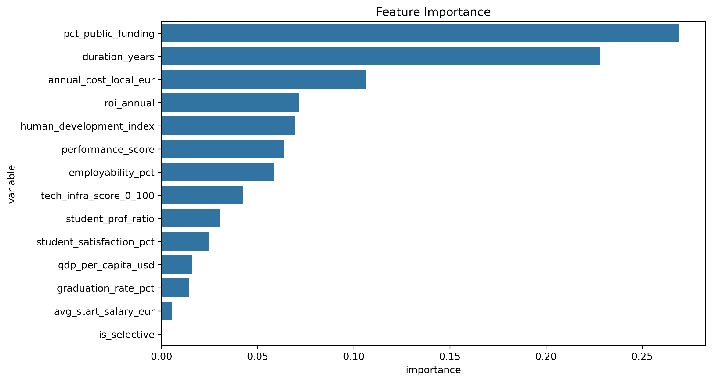
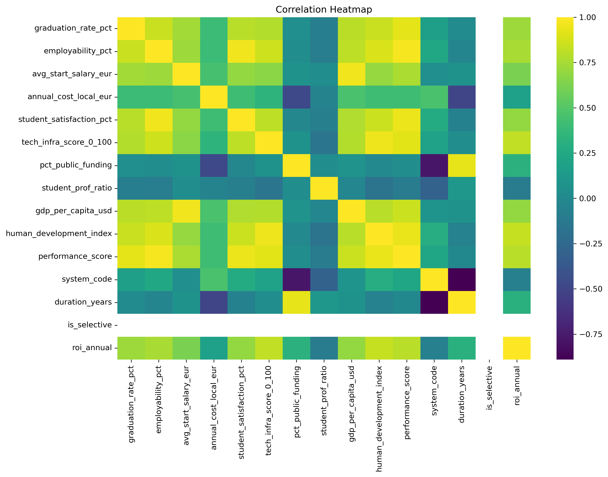

# Engineering Education Statistical Analysis & AI Impact Modeling

[](https://www.python.org/)
[](https://scikit-learn.org/)
[](https://scipy.org/)
[](#-machine-learning-classification)
[](https://opensource.org/licenses/MIT)

> **Comparative Statistical Modeling and Machine Learning Study of Engineering Education Systems.**  
> Investigates the structural impact of rapid Artificial Intelligence integration (2020–2025) across French (Grandes Écoles), German (Dual/Central European), and Anglo-Saxon engineering curricula. Group research project at ENSIT.

---

## 📌 Project Overview

As engineering institutions globally integrated machine learning and generative AI into their foundational curricula, educational architectures experienced contrasting friction. This project analyzes **124 synthetic and institutional observations** across **21 educational and labor-market metrics** to quantify:
1. Baseline structural performance across models (Employability, Annual ROI, Graduation Rate).
2. The counter-intuitive transition dynamics induced by rapid AI curriculum injection (+160% to +180% AI course content).
3. Supervised classification power to distinguish educational architectures.

### 🌟 Key Findings
- **Transition Friction**: Despite massive surges in AI competencies, short-term graduate employability exhibited temporary negative dips (−3.9% to −6.8%), most notably in the German dual system ($p = 0.032$), demonstrating sensitivity to rapid pedagogical disruptions.
- **Statistical Significance**: Kruskal-Wallis non-parametric tests confirmed statistically significant structural divergence ($p < 0.001$) across employability and ROI.
- **Machine Learning Classification**: A Random Forest classifier achieves **92.7% accuracy** in identifying educational architectures based on graduation rates, curricular structure, and ROI metrics.

---

## 📊 Key Results & Visualizations

| Educational Architecture | Sample Size ($N$) | Mean Employability | 95% Confidence Interval | Mean Annual ROI (%) |
|---|---|---|---|---|
| **Système Français (Grandes Écoles)** | 32 | 72.55% | [69.59%, 75.51%] | 162.66% |
| **Système Allemand / Europe Centrale** | 37 | 83.03% | [80.72%, 85.35%] | 202.67% |
| **Système Anglo-Saxon** | 55 | 78.65% | [76.52%, 80.79%] | 163.44% |

| Feature Importance (Random Forest) | Correlation Heatmap |
|:---:|:---:|
|  |  |

---

## 🏗️ Repository Structure

```
engineering-education-analysis/
├── data/
│   ├── sample_before_ai.csv           # Baseline curriculum & outcome metrics
│   └── sample_after_ai.csv            # Post-AI curriculum integration metrics
├── figures/
│   ├── correlation_heatmap.png        # Cross-metric correlation matrix
│   └── feature_importance.png         # Random Forest feature attribution
├── src/
│   ├── education_analyzer.py          # Core statistical pipeline & report generator
│   ├── run_analysis.py                # End-to-end execution script
│   └── test_education_analyzer.py     # Unit test suite
├── .gitignore
├── requirements.txt
└── README.md
```

---

## 🚀 Quick Start Guide

### 1. Installation
```bash
git clone https://github.com/IsraElAmri/engineering-education-analysis.git
cd engineering-education-analysis
pip install -r requirements.txt
```

### 2. Run the Analysis Pipeline
```bash
python src/run_analysis.py
```
This executes:
- Data validation and country standardization
- Non-parametric Kruskal-Wallis & Mann-Whitney U hypothesis tests
- K-Means clustering & PCA decomposition
- Random Forest model training & feature ranking
- Automatic generation of the HTML analysis report

### 3. Run Unit Tests
```bash
python -m unittest src/test_education_analyzer.py
```

---

## 👩‍💻 Authors
**Isra El Amri & Engineering Project Team (12 students)**  
National Higher Engineering School of Tunis (ENSIT)  
Contact: [elamriisra3@gmail.com](mailto:elamriisra3@gmail.com)
